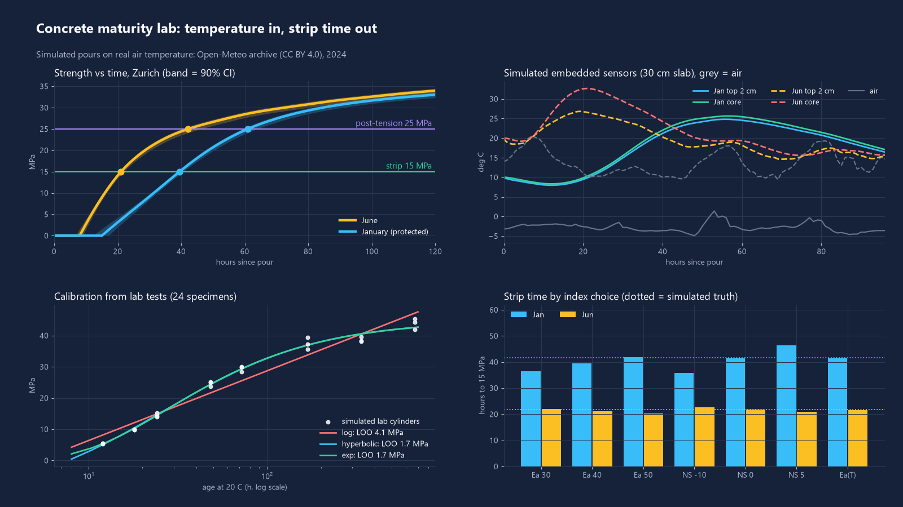
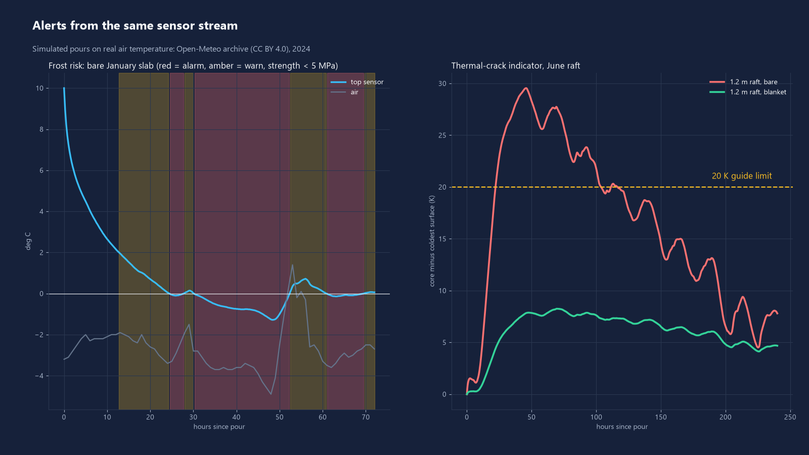
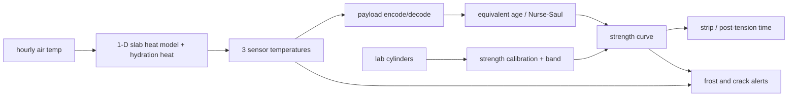

# concrete-maturity-lab

Open-source concrete curing monitor: embedded slab temperatures in, in-place strength, "strip formwork at X MPa" time, frost and thermal-crack alerts out.



## What it does

- **Maturity**: Nurse-Saul temperature-time factor (datum temperature), Arrhenius equivalent age (activation energy parameter), and a temperature-dependent activation energy variant.
- **Strength**: logarithmic, hyperbolic and exponential strength-maturity relationships, fitted from lab cube/cylinder results with fit error, leave-one-age-out error and a confidence band.
- **Decisions**: time to the strip threshold and the post-tensioning threshold, with best / conservative / optimistic times (conservative = lower 90% bound of the calibrated curve).
- **Alerts**: frost risk (concrete at or below 0 C while under a minimum strength, default 5 MPa), "protect now" advisory from the next 24 h of air temperature, and a core-surface temperature difference crack indicator (default 20 K guide limit).
- **Simulator**: 1-D slab heat model with cement hydration heat, driven by real hourly air temperature, produces the temperatures that three embedded sensors (top, core, soffit) would log.
- **Device side**: 8-12 byte LoRaWAN / BLE logger payload (up to 3 temperatures + battery + CRC-8), Python encoder/decoder and a JavaScript uplink decoder (`decoder/decoder.js`), tested against shared vectors.
- **Pour report**: markdown per pour (`python -m cmlab report --scenario zurich_jan`).

## Results

All pours are **simulated** (heat model) on **real** hourly air temperature: Open-Meteo historical archive, 2024-01-08 to 01-22 and 2024-06-10 to 06-24, Zurich and Davos grid points. Mix, lab tests and thresholds are simulated examples (15 MPa strip, 25 MPa post-tension); see "not verified yet". January pours use blanket plus insulated formwork, June pours are bare, 30 cm slab, fresh concrete 10 C (Jan) / 20 C (Jun).

| Measured (this repo, `python -m cmlab demo`) | Zurich | Davos (1546 m) |
|---|---|---|
| Strip time to 15 MPa, June pour | 21.1 h | 26.5 h |
| Strip time to 15 MPa, January pour | 39.5 h | 43.6 h |
| January minus June | +18.4 h | +17.1 h |
| Same, simulated truth | +19.9 h | +20.3 h |
| Post-tension 25 MPa, Jan / Jun | 60.9 h / 42.2 h | 69.7 h / 60.6 h |
| Strip estimate error vs simulated truth (Ea 40 kJ/mol), Jan / Jun | -2.2 h / -0.7 h | -3.5 h / -0.3 h |
| Fixed 7-day rule vs maturity strip time (Jan / Jun) | 128 h / 147 h earlier | 124 h / 142 h earlier |

Using the June strip time (21 h) on the January pour would strip at only about 3.8 MPa (simulated).

| Sensitivity of strip time (hours to 15 MPa) | Zurich Jan | Zurich Jun | Davos Jan |
|---|---|---|---|
| Arrhenius Ea 30 / 40 / 50 kJ/mol | 36.5 / 39.5 / 41.8 | 21.9 / 21.1 / 20.3 | 39.4 / 43.6 / 47.1 |
| Nurse-Saul datum -10 / 0 / +5 C | 35.9 / 41.5 / 46.3 | 22.6 / 21.7 / 21.0 | 38.8 / 47.0 / 54.6 |
| Temperature-dependent Ea (Hansen-Pedersen) | 41.4 | 21.6 | 46.7 |
| Simulated truth | 41.7 | 21.8 | 47.1 |

The datum or activation energy choice moves the January strip time by 5 to 16 h and the June strip time by 1 to 2 h. Cold pours are where the parameter matters.

| Calibration (24 simulated cylinders, 5% scatter, ages 12 h - 28 d) | RMSE | Leave-one-age-out |
|---|---|---|
| Hyperbolic (selected) | 1.22 MPa | 1.68 MPa |
| Exponential | 1.19 MPa | 1.69 MPa |
| Logarithmic | 2.98 MPa | 4.06 MPa |

Repeating the lab campaign with 60 different noise draws moves the strip time by sd 0.4 h (5-95%: -0.6 to +0.8 h) in January and June (Zurich).

| Alerts (simulated) | Result |
|---|---|
| Bare January slab, Zurich | frost alarm from 24.5 h (sensor at 0 C, strength below 5 MPa); the 40 kJ/mol index says strip at 78 h, the simulated truth is 160 h |
| Same pour with blanket + insulated formwork | no frost alarm; "protect now" advisory at pour time |
| 1.2 m raft, June, bare | core-surface difference 29.6 K, crack alarm from 22 h |
| 1.2 m raft, June, blanket | 8.2 K, no alert |

Method agreement on textbook worked examples is covered by unit tests (e.g. 24 h at 20 C with datum 0 C = 480 C*h; datum -10 C = 720 C*h; Arrhenius age factor at 30 C with 40 kJ/mol = 1.718).



## Quick start

```bash
python -m venv .venv && .venv/Scripts/python -m pip install -e ".[dev]"   # Linux/macOS: .venv/bin/python
python -m cmlab demo                    # numbers, results/*.json|md and docs/*.png (about 1 min)
python -m cmlab report --scenario zurich_jan
python -m cmlab decode 1c00010721099206a40c1c35    # decode a logger payload (hex)
python -m pytest -q && node decoder/test.js
```

Use it on your own data: calibrate with `cmlab.strength.calibrate(age_h, mpa, "hyperbolic")`, then feed readings into `cmlab.tracker.MaturityTracker` one uplink at a time.

## How it works



- Equivalent age: te = integral of exp(-Ea/R (1/T - 1/293.15)) dt (ASTM C1074; Freiesleben Hansen and Pedersen 1977). Nurse-Saul: M = integral of (T - T0) dt (Saul 1951), converted to hours at 20 C by dividing by (20 - T0).
- Strength models: log (Plowman 1956), hyperbolic (Carino 1984, ASTM C1074), exponential (Freiesleben Hansen and Pedersen 1985). The least mature of the sensors governs.
- Confidence band: parameter draws from the fit covariance (400 samples).
- Heat model: finite volume, backward Euler, degree of hydration alpha = exp(-(tau/te)^beta) (Schindler and Folliard 2005 form), surface conductances for air/blanket and formwork.
- The simulated "truth" uses the temperature-dependent activation energy (33.5 kJ/mol at 20 C and above, +1.47 kJ/mol per K below), so constant-Ea and Nurse-Saul estimates are tested against different kinetics, not their own.
- Payload: byte 0 version/channels/low-battery flag, u16 counter, n x int16 temperature (0.01 C, 0x8000 = fault), u16 battery mV, CRC-8. Layout in `cmlab/payload.py`.

## Data sources

- Air temperature: Open-Meteo Historical Weather API, hourly 2 m temperature, CC BY 4.0, reanalysis based (not a MeteoSwiss station record), grid points near Zurich (47.37 N, 8.54 E) and Davos (46.80 N, 9.84 E), January and June 2024. Fixture in `cmlab/data/weather_hourly.csv`; refresh with `scripts/fetch_weather.py`. https://open-meteo.com
- Methods: ASTM C1074 (maturity method), Carino and Lew 2001 (NIST, "The maturity method: from theory to application"), Nurse 1949 / Saul 1951, Plowman 1956, Freiesleben Hansen and Pedersen 1977 / 1985, Schindler and Folliard 2005.

## What is not verified yet

- No real concrete, real sensor or real lab test was used. Mix, cylinders (simulated with 5% scatter), heat-of-hydration parameters and surface conductances are typical values, not measurements.
- Simulated truth and estimators share the same family of model (an Arrhenius-type kinetics); real concrete will differ. Estimation errors above are a lower bound.
- Maturity numbers are not valid once concrete freezes. The tool raises an alarm instead of trusting the strength estimate; the constant-Ea index is optimistic in the cold (see the bare January result).
- Thresholds (15 / 25 / 5 MPa, 20 K) are example values. Use the project specification and the national concrete standard.
- Air temperature is reanalysis, not a site measurement; no solar gain, rain or wind variation in the heat model.
- Frost and crack indicators are screening alerts, not structural verification. Payload and decoder are tested against vectors, not on a radio link.

## Licence

MIT, Copyright (c) 2026 Victor Bonilla.
